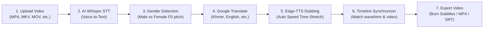

# MK Movie - Subtitle & Dubbing Studio

> **Khmer AI Subtitle, Dubbing & Video Hard-Sub Studio**  
> An all-in-one desktop and web application for automated video transcription (OpenAI Whisper), AI translation to Khmer, pitch-matched Edge-TTS voice dubbing, vocal separation (UVR AI), custom watermark branding, and hardware-accelerated (AMD AMF / NVIDIA NVENC / CPU) multi-episode batch video rendering.

---

## 🌟 Key Features

- **OpenAI Whisper AI Transcription**: Automatic multi-language speech-to-text (Chinese, English, etc.) with timestamp alignment.
- **Smart Khmer Translation**: Instant high-accuracy translation into Khmer (`km`) via Google Translate or Google Gemini AI.
- **Natural Voice Dubbing (Edge-TTS)**: Pitch-matched natural Khmer voices (`km-KH-PisethNeural`, `km-KH-SreymomNeural`) with automatic audio time-stretching to match original video lip sync.
- **UVR AI Vocal Separation**: Erase original speech while preserving background music & sound effects.
- **Custom Watermark & Brand Logo**: Upload and place custom logos (PNG/JPG/WEBP) at Top-Left, Top-Right, Bottom-Left, or Bottom-Right with live preview scaling.
- **Hardware-Accelerated Video Rendering**: Ultra-fast hard-sub burning with AMD AMF (`h264_amf`), NVIDIA NVENC (`h264_nvenc`), or CPU (`libx264`).
- **Batch Processing & Concat Demuxer**: Process multi-episode drama series simultaneously or combine multiple episodes into a single continuous movie with stream copy in seconds.
- **Native Desktop & Web Modes**: Launch as a lightweight native Windows desktop application (via PyWebView) or run as a local web server in your browser.

---

## 💻 System Requirements & Prerequisites

Before installing, ensure your system meets the following requirements:

- **Operating System**: Windows 10 / 11 (64-bit)
- **Python**: Python 3.10 – 3.13 (64-bit)
  - ⚠️ *Important*: During Python installation, check the box **"Add python.exe to PATH"**.
- **Node.js**: v18.0+ or v20+ LTS with npm ([Download Node.js](https://nodejs.org/))
- **Git**: Installed for cloning the repository ([Download Git](https://git-scm.com/))
- **Microsoft Edge WebView2**: Pre-installed on Windows 10/11 (required for PyWebView desktop window)
- **FFmpeg & FFprobe**: Included in the project `tools/` folder or installed in system `PATH`
- **Hardware Recommendations**:
  - **CPU**: Multi-core Intel or AMD processor (2.0 GHz+)
  - **RAM**: 8 GB minimum (16 GB recommended for Whisper STT & batch video rendering)
  - **GPU** (Optional): 
    - **NVIDIA GPU** (GTX 1060+ / RTX series): Enables CUDA acceleration for 4x faster Whisper speech-to-text and NVENC video burning.
    - **AMD GPU** (Radeon RX series): Supports AMD AMF hardware-accelerated video rendering.
    - **CPU Mode**: Fully supported out of the box if no dedicated GPU is available.

---

## ⚡ Quick Start (TL;DR)

If you already have Python and Node.js installed, open PowerShell in the project directory and run:

```powershell
# 1. Create and activate virtual environment
python -m venv venv
Set-ExecutionPolicy -Scope Process -ExecutionPolicy Bypass
.\venv\Scripts\Activate.ps1

# 2. Install backend dependencies
python -m pip install --upgrade pip
pip install -r requirements.txt

# 3. Build frontend assets
cd frontend
npm install
npm run build
cd ..

# 4. Launch Desktop Studio
.\run.bat
```

---

## 🚀 Step-by-Step Installation Guide

### Step 1: Clone or Download the Repository

Open Windows PowerShell or Command Prompt:

```powershell
git clone https://github.com/your-username/mk_subtitle.git
cd mk_subtitle
```

*(Or download the ZIP from GitHub and extract it to your preferred folder, e.g. `D:\Coding\mk_subtitle`)*.

---

### Step 2: Set Up Python Virtual Environment

A virtual environment keeps all project dependencies isolated and prevents version conflicts.

```powershell
# 1. Create virtual environment
python -m venv venv

# 2. Activate virtual environment
# On Windows PowerShell:
Set-ExecutionPolicy -Scope Process -ExecutionPolicy Bypass
.\venv\Scripts\Activate.ps1

# On Windows Command Prompt (CMD):
.\venv\Scripts\activate.bat
```

> [!TIP]
> If PowerShell shows an error stating *`running scripts is disabled on this system`*, run:  
> `Set-ExecutionPolicy -Scope Process -ExecutionPolicy Bypass` and then re-run `.\venv\Scripts\Activate.ps1`.

---

### Step 3: Install Backend Dependencies

Upgrade `pip` and install all required Python libraries:

```powershell
python -m pip install --upgrade pip
pip install -r requirements.txt
```

#### Optional: GPU Acceleration for NVIDIA Users (CUDA)

For blazing-fast Whisper speech-to-text (transcribe a 10-minute video in seconds) and AI vocal separation, install PyTorch with CUDA support:

```powershell
# For CUDA 12.4 (Latest NVIDIA Drivers):
pip install torch torchvision torchaudio --index-url https://download.pytorch.org/whl/cu124

# OR for CUDA 12.1:
pip install torch torchvision torchaudio --index-url https://download.pytorch.org/whl/cu121
```

> **Note**: AMD Radeon and Intel CPU users do **not** need to run this command — the standard PyTorch installed from `requirements.txt` is ready to use.

---

### Step 4: Verify FFmpeg Tools & AI Models

FFmpeg and FFprobe are required for extracting audio, processing waveforms, vocal separation, and burning hard-subs into MP4 videos.

1. **Automatic Project Detection**:
   - The application checks the project's `tools/` folder first (`tools\ffmpeg.exe` and `tools\ffprobe.exe`).
   - If already present in `tools/`, no extra setup is needed!
2. **If FFmpeg is missing from `tools/`**:
   - Install via Windows Package Manager:
     ```powershell
     winget install Gyan.FFmpeg
     ```
   - OR manually download from [Gyan.dev FFmpeg Builds](https://www.gyan.dev/ffmpeg/builds/) (Release Essentials `.zip`), extract, and place `ffmpeg.exe` and `ffprobe.exe` into the `tools/` folder.
3. **Verify in terminal**:
   ```powershell
   ffmpeg -version
   ffprobe -version
   ```
4. **AI Models (`models/` folder)**:
   - **UVR Vocal Separation Model**: Ensure `UVR-MDX-NET-Voc_FT.fp16acc.tflite` is present in the `models/` directory.
   - **Whisper Speech-to-Text Models**: Whisper automatically downloads your selected model size (`tiny`, `base`, `small`, `medium`, `large-v3`) on the first transcription and caches it locally.

---

### Step 5: Install Frontend Dependencies & Build

The application UI is built with React 19, Vite, and Tailwind CSS. The desktop application and production backend serve pre-compiled static assets from `frontend/dist`.

```powershell
# Navigate into the frontend folder
cd frontend

# Install Node.js packages
npm install

# Build static production bundle
npm run build

# Return to project root
cd ..
```

> [!IMPORTANT]
> Always run `npm run build` after pulling updates or before launching `run.bat` for the first time so the desktop window has the compiled interface ready to render.

---

### Step 6: Environment Configuration (Optional `.env`)

The app works immediately with **100% free Google Translate** (no API key required).

If you want to use **Google Gemini 2.5 Flash** for enhanced context-aware subtitle translation, create a `.env` file in the root folder:

```ini
# .env (in project root)

# Optional: Google Gemini API Key for smart movie translation
GEMINI_API_KEY=your_gemini_api_key_here

# Optional: Custom host and port (default is 127.0.0.1:8800)
MK_HOST=127.0.0.1
MK_PORT=8800
MK_DEBUG=True
```

---

## 🎬 How to Run the App

### Option A: One-Click Desktop Application (Recommended)

Simply double-click the launcher script in the project root:
**
```text
run.bat
```**

Or run via terminal:
```powershell
python desktop_app.py
```

- Launches a clean native Windows application window with dark mode, native title bar, and instant splash screen (< 0.8s).
- Automatically finds an open port (default: 8800) and starts the FastAPI engine in the background.

---

### Option B: Web Browser & Development Mode

If you prefer using your default browser (Chrome, Edge, Brave) or want live hot-reloading for code modifications:

1. **Start the FastAPI Backend**:
   ```powershell
   uvicorn backend.app.main:app --host 127.0.0.1 --port 8800 --reload
   ```

2. **Start the Frontend Vite Dev Server (in a second terminal)**:
   ```powershell
   cd frontend
   npm run dev
   ```

3. Open your browser and navigate to:  
   👉 **`http://localhost:5173`**

---

## 📦 Building Standalone Executable (.exe)

You can package the entire studio into a portable standalone Windows executable that can run on any Windows 10/11 PC without installing Python, Node.js, or FFmpeg:

```powershell
# Run the automated build script
.\build_desktop_exe.bat

# OR compile via Python CLI
python desktop_app.py --build
```

The compiled standalone executable and bundled assets will be placed in:
```text
dist\MK-Subtitle-Studio\MK-Subtitle-Studio.exe
```

---

## 🌟 Studio Features & Workflow Flowchart



| Feature | Description |
| :--- | :--- |
| **⚡ faster-whisper (CTranslate2)** | Ultra-fast STT engine with **4x speedup**, INT8 CPU/CUDA acceleration, Silero VAD filtering, and seamless OpenAI Whisper fallback. |
| **🎛️ Smart BGM Auto-Ducking** | Dynamic FFmpeg sidechain compression that smoothly lowers background music/audio during speech and automatically restores full volume during pauses. |
| **👥 Voice Gender Classification** | Analyzes fundamental vocal pitch (F0) to assign lines to **Male** or **Female** speakers automatically. |
| **🌐 Free Instant Translation** | Translate subtitles instantly across 50+ languages (Khmer, English, Chinese, Vietnamese, Thai, Japanese, etc.) with rate-limiting safety. |
| **🗣️ Multi-Voice Edge-TTS** | High quality neural TTS dubbing with automatic audio time-stretching so speech matches the duration of each subtitle line. |
| **⏱️ Interactive Timeline** | Precision subtitle synchronization, waveform view, drag-to-resize, and split/merge lines. |
| **🎞️ Hardsub Video Rendering** | Fast FFmpeg video encoding with customizable subtitle styling (font size, colors, outlines, bottom/top placement). |
| **📁 Universal Export** | Export to `.srt`, `.vtt`, `.ass`, `.txt`, standalone dubbed `.mp3`, or hardsubbed `.mp4`. |
| **⏳ Long-Form Video Support** | Efficient streaming and chunking handles short clips and long videos (1 hour+) without memory leaks. |

---

## 📁 Project Directory Structure

```text
mk_subtitle/
├── backend/
│   ├── app/
│   │   ├── main.py               # FastAPI application & REST endpoints
│   │   ├── config.py             # System paths, storage & FFmpeg config
│   │   ├── models/               # Pydantic schemas (subtitles, requests)
│   │   └── services/
│   │       ├── whisper_stt.py    # OpenAI Whisper speech-to-text
│   │       ├── translator.py     # Gemini & Google Translate services
│   │       ├── tts_engine.py     # Microsoft Edge-TTS Khmer synthesis
│   │       ├── vocal_separator.py# UVR vocal & BGM isolation
│   │       └── ffmpeg_runner.py  # Hard-sub burning, AMF encoder & concat
├── frontend/
│   ├── src/
│   │   ├── components/           # UI components (Timeline, Queue, ExportModal)
│   │   ├── utils/                # Time formatting & helpers
│   │   ├── App.jsx               # Main React Studio layout & state
│   │   └── main.jsx              # React DOM entry
│   └── package.json              # Vite & React dependencies
├── storage/                      # Audio cache, uploads & rendered exports
├── assets/                       # Branding logos & app icons
├── desktop_app.py                # Native PyWebView launcher & build script
├── run.bat                       # Quick desktop launcher
├── build_desktop_exe.bat         # PyInstaller one-click builder
├── requirements.txt              # Python dependencies
└── README.md                     # Documentation
```

---

## 🛠️ Troubleshooting & Frequently Asked Questions

### 1. PowerShell Script Execution Disabled Error
- **Symptom**: `.\venv\Scripts\Activate.ps1 : File cannot be loaded because running scripts is disabled on this system.`
- **Solution**: Open PowerShell and run:
  ```powershell
  Set-ExecutionPolicy -Scope Process -ExecutionPolicy Bypass
  .\venv\Scripts\Activate.ps1
  ```

### 2. Desktop Window Shows a Blank or White Screen
- **Symptom**: Running `run.bat` or `python desktop_app.py` displays a white or empty window.
- **Solution**:
  1. Ensure you have built the frontend assets:
     ```powershell
     cd frontend
     npm run build
     cd ..
     ```
  2. Verify that **Microsoft Edge WebView2 Runtime** is installed on your Windows PC (standard on Windows 10/11, or download from Microsoft).

### 3. FFmpeg or FFprobe Not Found
- **Symptom**: `FFmpeg is not installed or not in PATH` error during audio extraction or video burning.
- **Solution**:
  - Check if `ffmpeg.exe` and `ffprobe.exe` exist inside the `tools/` folder.
  - Or install via `winget install Gyan.FFmpeg` and restart your terminal.

### 4. GPU Acceleration (CUDA) Not Activating
- **Symptom**: Whisper transcription is slow or running on CPU instead of NVIDIA GPU.
- **Solution**: Check PyTorch CUDA availability:
  ```powershell
  python -c "import torch; print('CUDA available:', torch.cuda.is_available(), 'Device:', torch.cuda.get_device_name(0) if torch.cuda.is_available() else 'CPU')"
  ```
  If `CUDA available: False`, install the CUDA build of PyTorch:
  ```powershell
  pip install --force-reinstall torch torchvision torchaudio --index-url https://download.pytorch.org/whl/cu124
  ```

### 5. Port Conflict (Port 8800 or 8000 Already in Use)
- **Solution**: `desktop_app.py` automatically scans and binds to the next available free port (8801, 8802, etc.). You can also customize the port by setting `MK_PORT=8890` in your `.env` file.

### 6. Whisper Out of Memory (OOM) on Large Videos
- **Solution**: If your GPU has less than 6GB VRAM, choose `tiny`, `base`, or `small` in the STT model selector instead of `medium` or `large-v3`. The `base` and `small` models provide excellent accuracy with low memory footprint.

---

## 📄 License

This project is for personal, educational, and creative content creation. All third-party libraries (OpenAI Whisper, Microsoft Edge-TTS, FFmpeg) belong to their respective copyright holders.

