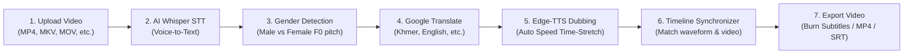

# MK Movie - Subtitle & Dubbing Studio

> **Khmer AI Subtitle, Dubbing & Video Hard-Sub Studio**  
> An all-in-one desktop and web application for automated video transcription (OpenAI Whisper & faster-whisper), AI translation to Khmer, pitch-matched Edge-TTS voice dubbing, vocal separation (UVR AI), custom watermark branding, and hardware-accelerated (AMD AMF / NVIDIA NVENC / CPU) multi-episode batch video rendering.

---

## 🌟 Key Features

- **OpenAI Whisper & faster-whisper STT**: Automatic multi-language speech-to-text (Chinese, English, etc.) with millisecond timestamp alignment and Silero VAD.
- **Smart Khmer Translation**: Instant high-accuracy translation into Khmer (`km`) via free Google Translate or Google Gemini AI.
- **Natural Voice Dubbing (Edge-TTS)**: Pitch-matched natural Khmer voices (`km-KH-PisethNeural`, `km-KH-SreymomNeural`) with automatic audio time-stretching to match original video lip sync.
- **UVR AI Vocal Separation**: Erase original speech while preserving background music & sound effects.
- **Custom Watermark & Brand Logo**: Upload and place custom logos (PNG/JPG/WEBP) at Top-Left, Top-Right, Bottom-Left, or Bottom-Right with live preview scaling.
- **Hardware-Accelerated Video Rendering**: Ultra-fast hard-sub burning with AMD AMF (`h264_amf`), NVIDIA NVENC (`h264_nvenc`), or CPU (`libx264`).
- **Batch Processing & Concat Demuxer**: Process multi-episode drama series simultaneously or combine multiple episodes into a single continuous movie with stream copy in seconds.
- **Native Desktop & Web Modes**: Launch as a lightweight native Windows desktop application (via PyWebView) or run as a local web server in your browser.

---

## 💻 System Requirements & Prerequisites (For New PCs)

Before running the application on a new PC, make sure the following foundational software is installed:

| Software | Required Version | Purpose | Download Link |
| :--- | :--- | :--- | :--- |
| **Windows OS** | Windows 10 / 11 (64-bit) | Operating System | Built-in |
| **Python** | 3.10, 3.11, or 3.12 (64-bit) | Backend API & AI Engine | [python.org/downloads](https://www.python.org/downloads/) |
| **Node.js** | v18.0+ or v20+ LTS (with npm) | Frontend Build & Vite UI | [nodejs.org](https://nodejs.org/) |
| **Git for Windows** | Latest | Cloning repository & updates | [git-scm.com](https://git-scm.com/) |
| **FFmpeg & FFprobe** | 6.0+ Essentials or Full | Audio extraction, burns & concat | [gyan.dev/ffmpeg](https://www.gyan.dev/ffmpeg/builds/) |
| **Edge WebView2** | Evergreen Runtime | Native Desktop Window UI | [developer.microsoft.com](https://developer.microsoft.com/en-us/microsoft-edge/webview2/) |

> [!CAUTION]
> **CRITICAL PYTHON INSTALLATION STEP**:  
> When running the Python installer on a new PC, you **MUST check the box: `[X] Add python.exe to PATH`** at the very bottom of the first setup screen! If you skip this, Windows will not recognize `python` or `pip` in the terminal.

---

## ⚡ Super Fast Setup via `winget` (Windows 10 / 11)

If you are setting up a brand-new Windows 10 or 11 PC, you do not need to browse websites to download installers individually. Windows includes **Windows Package Manager (`winget`)** by default.

Open **PowerShell as Administrator** (Right-click Start > *Terminal / PowerShell (Admin)*) and run this single block:

```powershell
# 1. Install all prerequisites at once
winget install -e --id Python.Python.3.11 --override "/passive InstallAllUsers=1 PrependPath=1"
winget install -e --id OpenJS.NodeJS.LTS
winget install -e --id Git.Git
winget install -e --id Gyan.FFmpeg
winget install -e --id Microsoft.EdgeWebView2Runtime
```

> [!IMPORTANT]
> **Restart your terminal** after running the `winget` commands so your system loads the new environment variables in `PATH`.

---

## 🚀 Installation Guide for a Fresh PC

You can install and configure the project using either **Method A (Automated 1-Click Script)** or **Method B (Step-by-Step Manual Setup)**.

---

### Method A: Automated 1-Click Setup (`setup.bat`) — *Recommended*

We provide an automated installer script `setup.bat` that validates all system tools, creates the virtual environment, installs Python packages, prompts for optional NVIDIA CUDA acceleration, and compiles the frontend UI automatically.

1. **Get the code**:
   ```powershell
   git clone https://github.com/your-username/mk_subtitle.git
   cd mk_subtitle
   ```
   *(Or download the ZIP from GitHub, right-click > Extract All, and open the folder)*.

2. **Run `setup.bat`**:
   - Double-click `setup.bat` in File Explorer, OR run in PowerShell:
   ```powershell
   .\setup.bat
   ```

3. **What `setup.bat` does automatically**:
   - ✅ Verifies Python 3.10+ is detected in `PATH`
   - ✅ Verifies Node.js and npm are available
   - ✅ Checks for FFmpeg (`tools/ffmpeg.exe` or system `PATH`)
   - ✅ Creates the Python virtual environment (`venv`)
   - ✅ Upgrades `pip` and installs all dependencies from `requirements.txt`
   - ✅ Prompts if you have an NVIDIA GPU to install CUDA 12.4 PyTorch acceleration
   - ✅ Runs `npm install` and `npm run build` in `frontend/`
   - ✅ Creates required storage directories (`storage/uploads`, `storage/audio_cache`, `storage/exports`)

4. **Launch the Studio**:
   - Double-click `run.bat` to start the desktop app!

---

### Method B: Step-by-Step Manual Installation

If you prefer installing manually or want complete control over each step:

#### Step 1: Clone or Download the Project

```powershell
# In PowerShell or Command Prompt:
git clone https://github.com/your-username/mk_subtitle.git
cd mk_subtitle
```

---

#### Step 2: Set Up FFmpeg & FFprobe

FFmpeg is essential for audio extraction, vocal separation, and subtitle burning.

Because git repositories do not track binary `.exe` files, check if you have FFmpeg:

1. **Option 1 (System-wide via winget - Easiest)**:
   ```powershell
   winget install Gyan.FFmpeg
   ```
   *Restart terminal and verify with `ffmpeg -version`*.

2. **Option 2 (Local `tools/` folder)**:
   - Download **ffmpeg-release-essentials.zip** from [Gyan.dev FFmpeg Builds](https://www.gyan.dev/ffmpeg/builds/).
   - Open the downloaded `.zip` file, go into the `bin/` folder.
   - Copy `ffmpeg.exe` and `ffprobe.exe` directly into the `mk_subtitle/tools/` folder:
     ```text
     mk_subtitle/
     └── tools/
         ├── ffmpeg.exe
         └── ffprobe.exe
     ```

---

#### Step 3: Set Up Python Virtual Environment

Create an isolated Python environment so dependencies do not conflict with other system software:

```powershell
# 1. Create the virtual environment
python -m venv venv

# 2. Allow PowerShell script execution for this session
Set-ExecutionPolicy -Scope Process -ExecutionPolicy Bypass

# 3. Activate the virtual environment
# In PowerShell:
.\venv\Scripts\Activate.ps1

# (OR in Command Prompt CMD):
# .\venv\Scripts\activate.bat
```

> [!TIP]
> When active, your terminal prompt will show `(venv)`.

---

#### Step 4: Install Backend Dependencies

Upgrade `pip` and install all necessary Python packages:

```powershell
# Make sure (venv) is active
python -m pip install --upgrade pip
pip install -r requirements.txt
```

---

#### Step 5: (Optional) Enable NVIDIA GPU Acceleration (CUDA)

- **If you have an NVIDIA Graphics Card (GTX 1060+, RTX 20/30/40/50 series)**:
  Install the CUDA-accelerated PyTorch build for 4x faster Whisper transcription and instant vocal separation:
  ```powershell
  pip install torch torchvision torchaudio --index-url https://download.pytorch.org/whl/cu124
  ```

- **If you have an AMD Radeon GPU or Intel / CPU**:
  No action needed! The standard PyTorch installed by `requirements.txt` already works out of the box with your CPU and AMD AMF hardware video encoder.

---

#### Step 6: Install Frontend Dependencies & Build UI

The frontend is built with React 19 and Vite. The backend serves pre-compiled production assets from `frontend/dist`:

```powershell
# 1. Enter the frontend folder
cd frontend

# 2. Install Node.js packages
npm install

# 3. Compile the production bundle
npm run build

# 4. Return to the main project root
cd ..
```

> [!IMPORTANT]
> The desktop window requires `frontend/dist` to exist. Always run `npm run build` once on a fresh machine or whenever pulling UI updates!

---

#### Step 7: Verify AI Models

1. **UVR Vocal Separation Model**:
   - The vocal separator model `models/UVR-MDX-NET-Voc_FT.fp16acc.tflite` is tracked in the repository.
   - Verify it exists in the `models/` folder.
2. **Whisper Speech-to-Text Models**:
   - You don't need to manually download Whisper models!
   - On your first transcription, faster-whisper automatically downloads your selected model (`tiny`, `base`, `small`, `medium`, or `large-v3`) and caches it in `models/whisper/` or your user cache.

---

#### Step 8: Optional Environment Settings (`.env`)

The studio works **100% out of the box with free Google Translate** (no API keys required).

If you want to use **Google Gemini 2.5 Flash** for smart context-aware movie subtitle translation, create a `.env` file in the project root:

```ini
# .env (in project root)

# Optional: Google Gemini API Key for smart movie translation
GEMINI_API_KEY=your_gemini_api_key_here

# Optional: Custom host and port (default is 127.0.0.1:8800)
MK_HOST=127.0.0.1
MK_PORT=8800
MK_DEBUG=True
```

---

## 🎬 How to Run the App

### Option 1: Native Desktop Application (Recommended)

Simply double-click:
```text
run.bat
```
*(The updated `run.bat` automatically detects and uses your `venv` virtual environment!)*

Or run from an activated terminal:
```powershell
python desktop_app.py
```

- Launches a clean native Windows application window with dark mode, native title bar, and instant splash screen.
- Automatically finds a free port (default: 8800) and starts the FastAPI server in the background.

---

### Option 2: Web Browser & Development Mode

If you prefer using your default browser (Chrome, Edge, Brave) or want live hot-reloading for editing code:

1. **Start the FastAPI Backend**:
   ```powershell
   .\venv\Scripts\Activate.ps1
   uvicorn backend.app.main:app --host 127.0.0.1 --port 8800 --reload
   ```

2. **Start the Frontend Vite Dev Server** *(in a second terminal)*:
   ```powershell
   cd frontend
   npm run dev
   ```

3. Open your browser and navigate to:  
   👉 **`http://localhost:5173`**

---

## 📦 Building Standalone Executable (.exe)

You can package the entire studio into a portable standalone Windows executable that can run on any Windows 10/11 PC without installing Python, Node.js, or FFmpeg:

```powershell
# Run the automated build script
.\build_desktop_exe.bat

# OR compile via Python CLI
python desktop_app.py --build
```

The compiled standalone executable and bundled assets will be placed in:
```text
dist\MK-Subtitle-Studio\MK-Subtitle-Studio.exe
```

---

## 🌟 Studio Features & Workflow Flowchart



| Feature | Description |
| :--- | :--- |
| **⚡ faster-whisper (CTranslate2)** | Ultra-fast STT engine with **4x speedup**, INT8 CPU/CUDA acceleration, Silero VAD filtering, and seamless OpenAI Whisper fallback. |
| **🎛️ Smart BGM Auto-Ducking** | Dynamic FFmpeg sidechain compression that smoothly lowers background music/audio during speech and automatically restores full volume during pauses. |
| **👥 Voice Gender Classification** | Analyzes fundamental vocal pitch (F0) to assign lines to **Male** or **Female** speakers automatically. |
| **🌐 Free Instant Translation** | Translate subtitles instantly across 50+ languages (Khmer, English, Chinese, Vietnamese, Thai, Japanese, etc.) with rate-limiting safety. |
| **🗣️ Multi-Voice Edge-TTS** | High quality neural TTS dubbing with automatic audio time-stretching so speech matches the duration of each subtitle line. |
| **⏱️ Interactive Timeline** | Precision subtitle synchronization, waveform view, drag-to-resize, and split/merge lines. |
| **🎞️ Hardsub Video Rendering** | Fast FFmpeg video encoding with customizable subtitle styling (font size, colors, outlines, bottom/top placement). |
| **📁 Universal Export** | Export to `.srt`, `.vtt`, `.ass`, `.txt`, standalone dubbed `.mp3`, or hardsubbed `.mp4`. |
| **⏳ Long-Form Video Support** | Efficient streaming and chunking handles short clips and long videos (1 hour+) without memory leaks. |

---

## 📁 Project Directory Structure

```text
mk_subtitle/
├── backend/
│   ├── app/
│   │   ├── main.py               # FastAPI application & REST endpoints
│   │   ├── config.py             # System paths, storage & FFmpeg discovery
│   │   ├── models/               # Pydantic schemas (subtitles, requests)
│   │   └── services/
│   │       ├── whisper_stt.py    # OpenAI Whisper speech-to-text
│   │       ├── translator.py     # Gemini & Google Translate services
│   │       ├── tts_engine.py     # Microsoft Edge-TTS Khmer synthesis
│   │       ├── vocal_separator.py# UVR vocal & BGM isolation
│   │       └── ffmpeg_runner.py  # Hard-sub burning, AMF encoder & concat
├── frontend/
│   ├── src/
│   │   ├── components/           # UI components (Timeline, Queue, ExportModal)
│   │   ├── utils/                # Time formatting & helpers
│   │   ├── App.jsx               # Main React Studio layout & state
│   │   └── main.jsx              # React DOM entry
│   ├── dist/                     # Compiled production UI bundle (served by backend)
│   └── package.json              # Vite & React dependencies
├── storage/                      # Audio cache, uploads & rendered exports
├── assets/                       # Branding logos & app icons
├── tools/                        # FFmpeg & FFprobe binaries (ffmpeg.exe, ffprobe.exe)
├── models/                       # UVR model & Whisper weights
├── desktop_app.py                # Native PyWebView launcher & build script
├── setup.bat                     # 1-Click Automated Setup for Fresh PCs
├── run.bat                       # Quick desktop launcher (venv-aware)
├── build_desktop_exe.bat         # PyInstaller one-click builder
├── requirements.txt              # Python dependencies
└── README.md                     # Documentation
```

---

## 🛠️ Troubleshooting & Frequently Asked Questions (New PC Edition)

### 1. `'python'` or `'pip'` is not recognized as an internal or external command
- **Cause**: Python was installed without checking the "Add to PATH" option.
- **Solution**:
  1. Download Python installer again from [python.org](https://www.python.org/downloads/).
  2. Launch installer, select **Modify**, and make sure **Add python.exe to PATH** is checked.
  3. Or manually add Python to User Environment Variables:
     - `C:\Users\<Username>\AppData\Local\Programs\Python\Python311\`
     - `C:\Users\<Username>\AppData\Local\Programs\Python\Python311\Scripts\`
  4. Restart your terminal.

---

### 2. PowerShell Script Execution Disabled Error
- **Symptom**: `.\venv\Scripts\Activate.ps1 : File cannot be loaded because running scripts is disabled on this system.`
- **Solution**: Run this command once in PowerShell:
  ```powershell
  Set-ExecutionPolicy -Scope Process -ExecutionPolicy Bypass
  .\venv\Scripts\Activate.ps1
  ```

---

### 3. `'npm'` is not recognized as an internal or external command
- **Cause**: Node.js was just installed, but the open terminal has not refreshed its PATH variables.
- **Solution**:
  1. Close all PowerShell / Command Prompt windows and open a new one.
  2. Type `node --version` and `npm --version` to verify.

---

### 4. FFmpeg or FFprobe Not Found
- **Symptom**: Error during audio extraction, waveform generation, or video burning: `FFmpeg is not installed or not in PATH`.
- **Solution**:
  - **Quick Fix**: Install via winget:
    ```powershell
    winget install Gyan.FFmpeg
    ```
  - **Manual Fix**: Download FFmpeg essentials from [gyan.dev/ffmpeg/builds/](https://www.gyan.dev/ffmpeg/builds/), extract, and place `ffmpeg.exe` and `ffprobe.exe` directly inside the `mk_subtitle/tools/` directory.

---

### 5. Desktop Window Shows a Blank or White Screen
- **Symptom**: Running `run.bat` or `python desktop_app.py` displays a white or blank window.
- **Solution**:
  1. The production frontend bundle has not been compiled yet. Run:
     ```powershell
     cd frontend
     npm run build
     cd ..
     ```
  2. Verify that **Microsoft Edge WebView2 Runtime** is installed. (Windows 10/11 normally includes it, but if you are on Windows N or Windows Server, download it from [Microsoft Edge WebView2](https://developer.microsoft.com/en-us/microsoft-edge/webview2/)).

---

### 6. NVIDIA GPU / CUDA Not Being Used (Running on Slow CPU)
- **Symptom**: Whisper transcription takes several minutes or task manager shows 0% GPU usage.
- **Solution**: Check whether PyTorch recognizes your NVIDIA GPU:
  ```powershell
  python -c "import torch; print('CUDA available:', torch.cuda.is_available(), 'Device:', torch.cuda.get_device_name(0) if torch.cuda.is_available() else 'CPU')"
  ```
  If it prints `CUDA available: False`, reinstall PyTorch with CUDA:
  ```powershell
  pip install --force-reinstall torch torchvision torchaudio --index-url https://download.pytorch.org/whl/cu124
  ```

---

### 7. Port Conflict (Port 8800 Already in Use)
- **Solution**: `desktop_app.py` automatically scans and binds to the next available free port (8801, 8802, etc.). You can also specify a custom port in your `.env` file:
  ```ini
  MK_PORT=8890
  ```

---

### 8. Whisper Out of Memory (OOM) on Large Videos
- **Solution**: If your GPU has less than 6GB VRAM, choose `tiny`, `base`, or `small` in the STT model selector in the UI instead of `large-v3`. The `base` and `small` models provide high accuracy while using minimal VRAM.

---

## 📄 License

This project is for personal, educational, and creative content creation. All third-party libraries (OpenAI Whisper, Microsoft Edge-TTS, FFmpeg) belong to their respective copyright holders.
