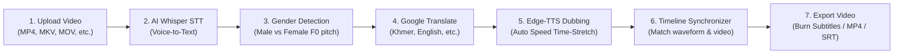

# MK Movie - Subtitle & Dubbing Studio

> **Khmer AI Subtitle, Dubbing & Video Hard-Sub Studio**  
> An all-in-one desktop and web application for automated video transcription (OpenAI Whisper & faster-whisper), AI translation to Khmer, pitch-matched Edge-TTS voice dubbing, vocal separation (UVR AI), custom watermark branding, and hardware-accelerated (AMD AMF / NVIDIA NVENC / CPU) multi-episode batch video rendering.

---

## ⚡ 1-Click All-in-One Setup (For Any New PC)

> [!TIP]
> **No manual software installation required!**  
> You do **not** need to manually search for or install Python, Node.js, FFmpeg, or CUDA first. Simply run **`setup.bat`** on your new PC and it will automatically check, download, install, and configure everything needed for all studio tools to function at 100%.

### How to Install:

1. **Download or Clone the Project**:
   ```powershell
   git clone https://github.com/your-username/mk_subtitle.git
   cd mk_subtitle
   ```
   *(Or download the ZIP from GitHub, right-click > **Extract All**, and open the folder)*.

2. **Double-click `setup.bat`**:
   - Simply double-click **`setup.bat`** in File Explorer (or run `.\setup.bat` in PowerShell).

3. **What `setup.bat` does automatically**:
   - 🔍 **Python**: Detects existing Python (3.10–3.12) or installs Python 3.11 with PATH configuration automatically.
   - 📦 **Node.js & npm**: Checks for Node.js LTS; installs it automatically if missing.
   - 🎥 **FFmpeg & FFprobe**: Automatically downloads and extracts official FFmpeg essentials directly into `tools\ffmpeg.exe` and `tools\ffprobe.exe`.
   - 🪟 **Microsoft Edge WebView2**: Verifies the desktop runtime is installed; installs silently if missing.
   - 🐍 **Virtual Environment (`venv`)**: Creates an isolated Python environment and installs all requirements (`requirements.txt`).
   - ⚡ **GPU Auto-Detection (CUDA)**: Automatically checks for an NVIDIA graphics card and installs CUDA 12.4 PyTorch acceleration (or optimizes for CPU/AMD AMF).
   - 🎨 **Frontend UI**: Automatically installs packages and builds the production React 19 / Vite interface (`frontend/dist`).
   - 🤖 **AI Models**: Verifies the UVR vocal separation model and pre-caches the Whisper AI speech model.
   - 🚀 **1-Click Launch**: Displays a health check summary and offers to launch the studio immediately!

---

## 🛠️ How All Studio Tools Function Out of the Box

Once `setup.bat` finishes, every feature in the studio is fully operational:

| Feature / Tool | Status After `setup.bat` | Hardware Acceleration |
| :--- | :--- | :--- |
| **🎙️ Speech-to-Text (STT)** | **Ready** — OpenAI Whisper & faster-whisper with Silero VAD | NVIDIA CUDA (4x speedup) or CPU INT8 |
| **🌐 Translation to Khmer** | **Ready** — 100% Free Google Translate built-in (no API key needed) | Cloud API (Instant) |
| **🗣️ Khmer Voice Dubbing** | **Ready** — Microsoft Edge-TTS Neural voices (`Piseth` & `Sreymom`) | Auto Lip-Sync Time-Stretching |
| **🎵 UVR Vocal Separation** | **Ready** — MDX-Net AI Vocal & Background Music isolation | AI-Edge LiteRT / TFLite engine |
| **🎬 Video Hardsub Burning** | **Ready** — High-speed video rendering with custom watermark & styles | AMD AMF (`h264_amf`) / NVIDIA NVENC / CPU |
| **🎞️ Batch Concat Demuxer** | **Ready** — Multi-episode merging without re-encoding in seconds | FFmpeg Stream Copy |
| **🖥️ Desktop Application** | **Ready** — Lightweight native Windows window with splash screen | Microsoft Edge WebView2 |

---

## 🎬 How to Run the Studio

### Option 1: Native Desktop Application (Recommended)

Simply double-click:
```text
run.bat
```
*(The launcher automatically detects your `venv` virtual environment and opens the clean native desktop window)*.

Or run from an activated terminal:
```powershell
python desktop_app.py
```

---

### Option 2: Web Browser & Development Mode

If you prefer using your default browser (Chrome, Edge, Brave) or want live code hot-reloading:

1. **Start the FastAPI Backend**:
   ```powershell
   .\venv\Scripts\Activate.ps1
   uvicorn backend.app.main:app --host 127.0.0.1 --port 8800 --reload
   ```

2. **Start the Frontend Vite Dev Server** *(in a second terminal)*:
   ```powershell
   cd frontend
   npm run dev
   ```

3. Open your browser and navigate to:  
   👉 **`http://localhost:5173`**

---

## ⚙️ Optional Configuration (`.env`)

The app works immediately with **100% free Google Translate** (no API key required).

If you want to use **Google Gemini 2.5 Flash** for enhanced context-aware movie subtitle translation, create a `.env` file in the project root:

```ini
# .env (in project root)

# Optional: Google Gemini API Key for smart movie translation
GEMINI_API_KEY=your_gemini_api_key_here

# Optional: Custom host and port (default is 127.0.0.1:8800)
MK_HOST=127.0.0.1
MK_PORT=8800
MK_DEBUG=True
```

---

## 📦 Building Standalone Executable (.exe)

You can package the entire studio into a portable standalone Windows executable that can run on any Windows 10/11 PC without installing Python, Node.js, or FFmpeg:

```powershell
# Run the automated build script
.\build_desktop_exe.bat

# OR compile via Python CLI
python desktop_app.py --build
```

The compiled standalone executable and bundled assets will be placed in:
```text
dist\MK-Subtitle-Studio\MK-Subtitle-Studio.exe
```

---

## 🌟 Studio Features & Workflow Flowchart



| Feature | Description |
| :--- | :--- |
| **⚡ faster-whisper (CTranslate2)** | Ultra-fast STT engine with **4x speedup**, INT8 CPU/CUDA acceleration, Silero VAD filtering, and seamless OpenAI Whisper fallback. |
| **🎛️ Smart BGM Auto-Ducking** | Dynamic FFmpeg sidechain compression that smoothly lowers background music/audio during speech and automatically restores full volume during pauses. |
| **👥 Voice Gender Classification** | Analyzes fundamental vocal pitch (F0) to assign lines to **Male** or **Female** speakers automatically. |
| **🌐 Free Instant Translation** | Translate subtitles instantly across 50+ languages (Khmer, English, Chinese, Vietnamese, Thai, Japanese, etc.) with rate-limiting safety. |
| **🗣️ Multi-Voice Edge-TTS** | High quality neural TTS dubbing with automatic audio time-stretching so speech matches the duration of each subtitle line. |
| **⏱️ Interactive Timeline** | Precision subtitle synchronization, waveform view, drag-to-resize, and split/merge lines. |
| **🎞️ Hardsub Video Rendering** | Fast FFmpeg video encoding with customizable subtitle styling (font size, colors, outlines, bottom/top placement). |
| **📁 Universal Export** | Export to `.srt`, `.vtt`, `.ass`, `.txt`, standalone dubbed `.mp3`, or hardsubbed `.mp4`. |
| **⏳ Long-Form Video Support** | Efficient streaming and chunking handles short clips and long videos (1 hour+) without memory leaks. |

---

## 📁 Project Directory Structure

```text
mk_subtitle/
├── setup.bat                     # ⚡ 1-Click All-in-One Automated Setup (Run this first!)
├── setup.ps1                     # Complete PowerShell setup engine
├── run.bat                       # Quick desktop launcher (venv-aware)
├── build_desktop_exe.bat         # Standalone .exe compiler
├── desktop_app.py                # Native PyWebView desktop launcher
├── requirements.txt              # Backend Python dependencies
├── backend/
│   ├── app/
│   │   ├── main.py               # FastAPI application & REST endpoints
│   │   ├── config.py             # System paths, storage & FFmpeg discovery
│   │   ├── models/               # Pydantic schemas (subtitles, requests)
│   │   └── services/
│   │       ├── whisper_stt.py    # OpenAI Whisper & faster-whisper speech-to-text
│   │       ├── translator.py     # Gemini & Google Translate services
│   │       ├── tts_engine.py     # Microsoft Edge-TTS Khmer synthesis
│   │       ├── vocal_separator.py# UVR vocal & BGM isolation
│   │       └── ffmpeg_runner.py  # Hard-sub burning, AMF encoder & concat
├── frontend/
│   ├── src/
│   │   ├── components/           # UI components (Timeline, Queue, ExportModal)
│   │   ├── utils/                # Time formatting & helpers
│   │   ├── App.jsx               # Main React Studio layout & state
│   │   └── main.jsx              # React DOM entry
│   ├── dist/                     # Compiled production UI bundle (served by backend)
│   └── package.json              # Vite & React dependencies
├── storage/                      # Audio cache, uploads & rendered exports
├── assets/                       # Branding logos & app icons
├── tools/                        # FFmpeg & FFprobe binaries (ffmpeg.exe, ffprobe.exe)
├── models/                       # UVR model & Whisper weights
└── README.md                     # Documentation
```

---

## 🔧 Advanced: Manual Step-by-Step Installation

If you prefer installing tools manually without using `setup.bat`:

<details>
<summary><b>Click to expand manual setup instructions</b></summary>

### 1. Prerequisites Download Links:
- **Python**: [python.org/downloads](https://www.python.org/downloads/) (3.10–3.12, remember to check `[X] Add python.exe to PATH`).
- **Node.js**: [nodejs.org](https://nodejs.org/) (LTS version).
- **FFmpeg**: [gyan.dev/ffmpeg/builds](https://www.gyan.dev/ffmpeg/builds/) (extract `ffmpeg.exe` and `ffprobe.exe` into `tools/`).
- **Git**: [git-scm.com](https://git-scm.com/).

Or install all at once via Windows Package Manager:
```powershell
winget install -e --id Python.Python.3.11 --override "/passive InstallAllUsers=1 PrependPath=1"
winget install -e --id OpenJS.NodeJS.LTS
winget install -e --id Gyan.FFmpeg
winget install -e --id Microsoft.EdgeWebView2Runtime
```

### 2. Manual Commands:
```powershell
# 1. Create and activate virtual environment
python -m venv venv
Set-ExecutionPolicy -Scope Process -ExecutionPolicy Bypass
.\venv\Scripts\Activate.ps1

# 2. Install backend dependencies
python -m pip install --upgrade pip
pip install -r requirements.txt

# (Optional: If NVIDIA GPU, install CUDA PyTorch):
# pip install torch torchvision torchaudio --index-url https://download.pytorch.org/whl/cu124

# 3. Build frontend bundle
cd frontend
npm install
npm run build
cd ..

# 4. Launch Studio
.\run.bat
```
</details>

---

## 🛠️ Troubleshooting & Frequently Asked Questions

### 1. PowerShell Script Execution Disabled Error
- **Symptom**: `File cannot be loaded because running scripts is disabled on this system.`
- **Solution**: Double-clicking `setup.bat` automatically runs with `-ExecutionPolicy Bypass`. If running manually in PowerShell, run:
  ```powershell
  Set-ExecutionPolicy -Scope Process -ExecutionPolicy Bypass
  .\setup.bat
  ```

---

### 2. Windows SmartScreen or Antivirus Prompt
- **Symptom**: Windows displays *"Windows protected your PC"* when launching `setup.bat`.
- **Solution**: Click **More info** > **Run anyway**. This appears because `setup.bat` was downloaded from the internet.

---

### 3. Blank or White Screen in Desktop Window
- **Solution**:
  1. Ensure the frontend has been compiled:
     ```powershell
     cd frontend
     npm run build
     cd ..
     ```
  2. Verify **Microsoft Edge WebView2 Runtime** is installed. `setup.bat` installs it automatically, or download from [Microsoft Edge WebView2](https://developer.microsoft.com/en-us/microsoft-edge/webview2/).

---

### 4. GPU Acceleration (CUDA) Check
- Check whether PyTorch recognizes your NVIDIA GPU:
  ```powershell
  .\venv\Scripts\python.exe -c "import torch; print('CUDA available:', torch.cuda.is_available(), 'Device:', torch.cuda.get_device_name(0) if torch.cuda.is_available() else 'CPU')"
  ```
  If `CUDA available: False` on an NVIDIA GPU, reinstall CUDA PyTorch:
  ```powershell
  .\venv\Scripts\pip.exe install --force-reinstall torch torchvision torchaudio --index-url https://download.pytorch.org/whl/cu124
  ```

---

### 5. Port Conflict (Port 8800 Already in Use)
- `desktop_app.py` automatically detects in-use ports and binds to the next available free port (8801, 8802, etc.). You can also specify a custom port in `.env`:
  ```ini
  MK_PORT=8890
  ```

---

## 📄 License

This project is for personal, educational, and creative content creation. All third-party libraries (OpenAI Whisper, Microsoft Edge-TTS, FFmpeg) belong to their respective copyright holders.
