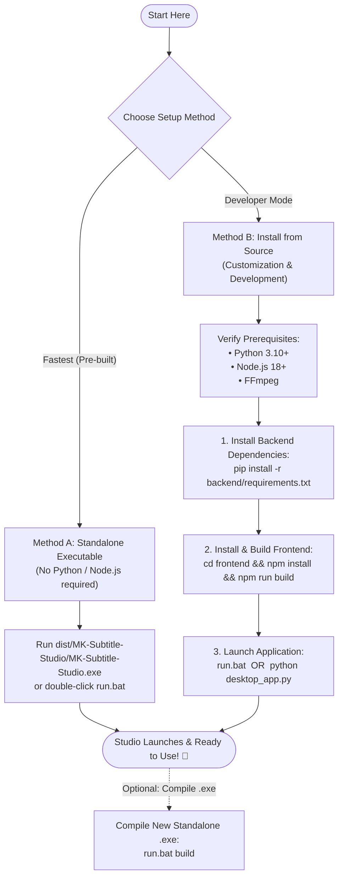
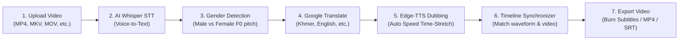

# 🎬 MK Subtitle & Dubbing Studio

An all-in-one AI-powered desktop studio for **Video Subtitling, Automatic Speech Recognition (STT), Voice Gender Detection, Instant Translation, and Multi-Speaker AI Dubbing (TTS)** on Windows.

Built with **FastAPI**, **React 19**, **OpenAI Whisper**, **Edge-TTS**, and **PyWebView**.

---

## 🚀 Quick Overview & Installation Flow

Choose the path that best matches your needs:



---

## ⚡ Method A: Quick Launch (Pre-Built Executable)

If you already have the pre-built distribution in `dist/MK-Subtitle-Studio/`:

1. **Double-click `run.bat`** (or open `dist\MK-Subtitle-Studio\MK-Subtitle-Studio.exe`).
2. The native desktop app opens immediately with:
   - Bundled **OpenAI Whisper** offline model assets.
   - Bundled **FFmpeg / FFprobe** media engine.
   - Zero terminal popups (silent background backend).

---

## 🛠️ Method B: Developer Setup (Install from Source)

Follow these steps if you want to run the project from source, make code modifications, or rebuild the standalone package.

### 1. Prerequisites

Make sure the following tools are installed on your Windows system:
- **Python 3.10 – 3.13** ([Download Python](https://www.python.org/downloads/))  
  *(Ensure `Add python.exe to PATH` is checked during installation)*
- **Node.js 18+ & npm** ([Download Node.js](https://nodejs.org/))
- **FFmpeg** (Recommended on system PATH, or placed in `tools/ffmpeg.exe`)

---

### 2. Step-by-Step Installation

#### Step 1: Clone or Open Workspace
```bash
cd d:\Coding\mk_subtitle
```

#### Step 2: Set Up Python Virtual Environment
```bash
# Create virtual environment
python -m venv venv

# Activate virtual environment (Windows Command Prompt)
venv\Scripts\activate.bat

# Or in PowerShell:
venv\Scripts\Activate.ps1
```

#### Step 3: Install Backend Dependencies
```bash
pip install --upgrade pip
pip install -r backend/requirements.txt
```

#### Step 4: Install & Build Frontend
```bash
cd frontend
npm install
npm run build
cd ..
```

---

### 3. Launching the App

Once installed, you can launch the application with any of the following:

- **Option 1 (Easiest)**: Double-click **`run.bat`** in the project root.
- **Option 2 (Terminal)**:
  ```bash
  python desktop_app.py
  ```
- **Option 3 (Dev Server Mode)**:
  ```bash
  # In terminal 1 (Backend API):
  python -m uvicorn backend.app.main:app --host 127.0.0.1 --port 8800 --reload

  # In terminal 2 (Vite HMR UI):
  cd frontend
  npm run dev
  ```

---

## 📦 Building Standalone Desktop Executable (`.exe`)

To compile the entire app (FastAPI + Vite frontend + Whisper assets + FFmpeg) into an independent standalone folder distribution:

```bash
# Using run.bat shortcut:
run.bat build

# OR directly with Python:
python desktop_app.py --build
```

The output will be created at:
```text
dist\MK-Subtitle-Studio\MK-Subtitle-Studio.exe
```
This executable is fully portable and can be run without Python or Node.js installed on the host machine.

---

## 🌟 Studio Features & Workflow Flowchart



| Feature | Description |
| :--- | :--- |
| **🎙️ Whisper Speech-to-Text** | Offline speech-to-text with auto word-level / sentence timestamp extraction. |
| **👥 Voice Gender Classification** | Analyzes fundamental vocal pitch (F0) to assign lines to **Male** or **Female** speakers automatically. |
| **🌐 Free Instant Translation** | Translate subtitles instantly across 50+ languages (Khmer, English, Chinese, Vietnamese, Thai, Japanese, etc.) with rate-limiting safety. |
| **🗣️ Multi-Voice Edge-TTS** | High quality neural TTS dubbing with automatic audio time-stretching so speech matches the duration of each subtitle line. |
| **⏱️ Interactive Timeline** | Precision subtitle synchronization, waveform view, drag-to-resize, and split/merge lines. |
| **🎞️ Hardsub Video Rendering** | Fast FFmpeg video encoding with customizable subtitle styling (font size, colors, outlines, bottom/top placement). |
| **📁 Universal Export** | Export to `.srt`, `.vtt`, `.ass`, `.txt`, standalone dubbed `.mp3`, or hardsubbed `.mp4`. |
| **⏳ Long-Form Video Support** | Efficient streaming and chunking handles short clips and long videos (1 hour+) without memory leaks. |

---

## 📂 Project Structure

```text
mk_subtitle/
├── backend/
│   ├── app/
│   │   ├── api/routes/          # REST API endpoints (transcription, translation, dubbing, export)
│   │   ├── models/              # Pydantic data schemas
│   │   ├── services/            # Core AI engines (whisper_stt, edge_tts, video_generator)
│   │   ├── config.py            # Global paths, FFmpeg discovery, directory setups
│   │   └── main.py              # FastAPI application entry
│   └── requirements.txt         # Python dependencies
├── frontend/
│   ├── src/
│   │   ├── components/          # VideoPlayer, TimelineEditor, SubtitleDataTable, ExportModal
│   │   ├── services/api.js      # Backend API connector
│   │   ├── App.jsx              # Main UI layout & state
│   │   └── index.css            # Tailwind CSS styling
│   ├── package.json             # Frontend dependencies
│   └── vite.config.js           # Vite bundling configuration
├── tools/                       # Bundled ffmpeg.exe & ffprobe.exe
├── dist/MK-Subtitle-Studio/     # Standalone portable Windows executable distribution
├── desktop_app.py               # Desktop PyWebView runner & PyInstaller build script
├── run.bat                      # One-click launcher and build script
└── README.md                    # Project documentation
```

---

## ❓ Frequently Asked Questions & Troubleshooting

### 1. `mel_filters.npz` or Whisper token error
- **Cause**: PyInstaller missed Whisper model asset files in standalone mode.
- **Solution**: The app includes automatic fallback logic in `backend/app/services/whisper_stt.py` using `librosa.filters.mel`. Whisper assets (`mel_filters.npz`, `multilingual.tiktoken`) are automatically placed in `dist/MK-Subtitle-Studio/_internal/whisper/assets/`.

### 2. `FFmpeg not found`
- **Solution**: The studio automatically looks for `tools/ffmpeg.exe` inside the app folder, on the system `PATH`, and in common installation directories. Standalone builds bundle FFmpeg into `dist/MK-Subtitle-Studio/tools/`.

### 3. Port `8800` already in use
- **Solution**: The backend automatically searches for the next open port (8801, 8802...) dynamically on startup.

---

## 📄 License
This project is for personal, educational, and creative content creation workflows.

